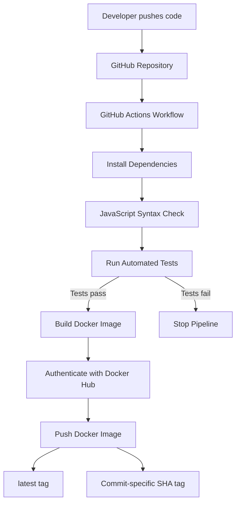

# DevOps CI/CD Automation

Automated testing and Docker image publishing for a Node.js application using GitHub Actions.

## Project Overview

This project demonstrates a Continuous Integration and Continuous Deployment (CI/CD) pipeline that automatically tests a Node.js application, builds a Docker image, and publishes the image to Docker Hub whenever code is pushed to the main branch.

## Technologies Used

- Node.js and Express.js
- Git and GitHub
- GitHub Actions
- Docker
- Docker Hub
- Node.js built-in test runner
- Supertest

## Architecture



## Application Endpoints

| Endpoint | Description |
|---|---|
| `/` | Returns application details and version |
| `/health` | Returns application health status |
| `/status` | Returns environment, uptime, and operational status |

## Automated Testing

The test suite checks:

1. Home endpoint response.
2. Health endpoint response.
3. Status endpoint response.
4. Unknown route handling (404).

Run the tests locally:

```bash
npm ci
npm test
npm run check
```

## CI/CD Pipeline

The GitHub Actions workflow:

1. Checks out the repository.
2. Sets up Node.js.
3. Installs dependencies.
4. Checks JavaScript syntax.
5. Runs automated tests.
6. Builds the Docker image only after tests pass.
7. Publishes the image to Docker Hub.

Pull requests targeting `main` run the test job without publishing an image. Manual workflow execution is also supported.

## Run Locally

Install dependencies:

```bash
npm install
```

Start the application:

```bash
npm start
```

Open `http://localhost:3000/` in your browser or test the endpoints using PowerShell:

```powershell
Invoke-RestMethod http://localhost:3000/
Invoke-RestMethod http://localhost:3000/health
Invoke-RestMethod http://localhost:3000/status
```

## Run with Docker

Build the image:

```bash
docker build -t devops-cicd-automation:1.0 .
```

Start the container:

```bash
docker run -d --name devops-cicd-app -p 3000:3000 devops-cicd-automation:1.0
```

Test the health endpoint:

```powershell
Invoke-RestMethod http://localhost:3000/health
```

Stop and remove the container when finished:

```bash
docker rm -f devops-cicd-app
```

## Docker Hub

Published image repository:

https://hub.docker.com/r/sandhyasteffy/devops-cicd-automation

Available tags include `latest` and a commit-specific `sha-...` tag.

Pull the latest image:

```bash
docker pull sandhyasteffy/devops-cicd-automation:latest
```

Run the published image:

```bash
docker run -d --name devops-cicd-demo -p 3000:3000 sandhyasteffy/devops-cicd-automation:latest
```

## GitHub Actions Secrets

Configure these repository secrets under **Settings → Secrets and variables → Actions**:

- `DOCKERHUB_USERNAME`
- `DOCKERHUB_TOKEN`

Never commit access tokens, passwords, or `.env` files to the repository.

## Project Outcomes

- Automated application testing.
- Automated Docker image building.
- Automated publishing to Docker Hub.
- Versioned images using commit-specific tags.
- Repeatable container deployment.

## Author

Sandhya Steffy M.

GitHub: https://github.com/Sandhyasteffy
